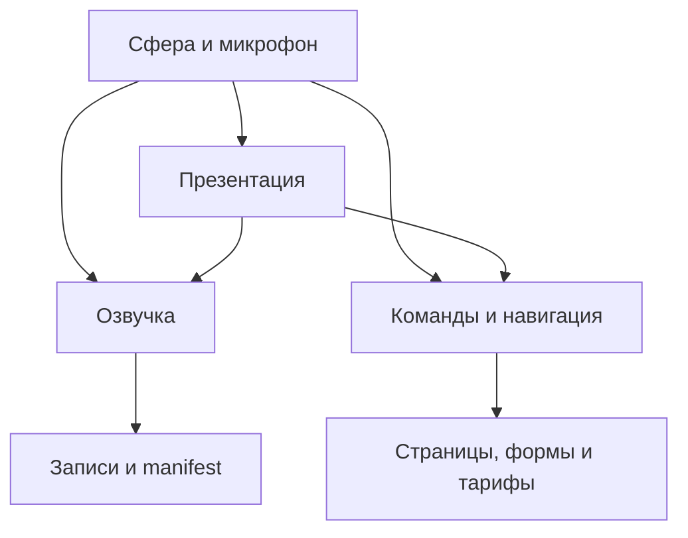

# Jarvis: дерево компонентов и сохранение рабочего результата

Распоряжение владельца, 4 ноября 2026: изменения должны учитывать все связанные части; проверенные функции записывать и сохранять при следующих правках.

## Что является источником истины

- `JARVIS_COMPONENTS.json` — дерево компонентов, их связей, контрактов и общий список регрессионных тестов.
- Фактические ES-import/export проверяются линкером Node без выполнения браузерного кода. Дерево реальных импортов: `npm run check:jarvis -- --tree`.
- `JARVIS_VERIFIED_BASELINE.json` — последняя зафиксированная версия, точный Render deploy и доказательства по каждой возможности. Непроверенное не обозначается работающим.
- Существующие `OWNER_FINAL_PAGE_DESIGN_LOCK.json` и `PRICING_OWNER_ART_LOCK.json` продолжают действовать отдельно. Новые проверки не отменяют старые.

## Обязательный порядок изменения

1. Зафиксировать просьбу и критерии; получить свежие DEV, feature и текущий Render SHA. Найти затронутый компонент в дереве. Для изменения интерфейса функции проверить все импорты и вызовы, тесты, конфигурацию и данные, которых касается изменение. Переписывать весь проект не требуется.
2. Править только согласованную область. Рабочие сценарии остаются обязательными проверками. Перенос файла/переименование экспорта требует согласованного обновления всех потребителей.
3. Запустить `npm run check:jarvis`. Проверка связывает реальные ES-модули, проверяет 344 текущих записи по manifest и запускает регрессии. Повреждённые импорты, отсутствующий экспорт, второй singleton через query URL, неверный SHA аудио и сломанные сценарии дают ненулевой exit code.
4. Для поручения «только аудио» дополнительно выполнить `npm run check:jarvis -- --audio-only <полный-SHA-проверенной-базы>`. В таком релизе нельзя незаметно заменить JS/HTML/CSS. Обновляются только записи и необходимые метаданные внутри `media/jarvix/`.
5. Публиковать точный проверенный SHA только в TEST. Сопоставить фактический deployed SHA и затронутые HTTP-ресурсы, выполнить соответствующий пользовательский сценарий. Для изменения интерфейса — desktop/mobile; для реального микрофона/качества звука — соответствующая проверка, не подмена mock-тестом.
6. Дописать доказательства в baseline: источник, Render deploy, сценарий, результат и ограничения. Не повышать автоматически непроверенные пункты до VERIFIED. Если проверка недоступна, зафиксировать это явно. Сохранить прежнюю проверенную версию для точечного отката, сохраняя параллельные одобренные изменения.

## Где стоит автоматический барьер

- `npm run check:jarvis` — одна команда для локальной проверки и CI.
- `postinstall` вызывает эту команду: существующая Render-сборка `npm ci --omit=dev --no-audit --no-fund` не завершится успешно, если проверка упадёт. Ограничение параллельности тестов снижает нагрузку.
- `.github/workflows/jarvix-guided-tour-test.yml` запускает тот же набор при изменении компонентов, страниц, аудио, реестра, тестов и конфигурации. Проверки не обращаются к платным провайдерам и не генерируют новые голосовые файлы.
- Для проверки механизма есть отрицательные fixtures: синтаксически корректный файл с отсутствующим экспортом, раздвоение core через `?v=`, несовпадение аудио с manifest и посторонний JS в audio-only релизе должны быть отклонены.

Барьер защищает версии, в которых он присутствует и не отключён. Старый исторический коммит без него или установка с `--ignore-scripts` могут его обойти. Документ не делает изменение невозможным для администратора. Обязательность GitHub branch protection отдельно не настраивалась. Эти ограничения запрещено скрывать обещанием «никто больше не сломает».

## Границы подтверждения

Проверка модулей не запускает распознавание речи и не оценивает тембр. HTTP 200 и Render Live не доказывают качество разговора. Подключение модели, доступность домашнего сервера и микрофон проверяются отдельно. Production `srv-dalqnkoae00c73caj8vg` не публикуется этой процедурой.
